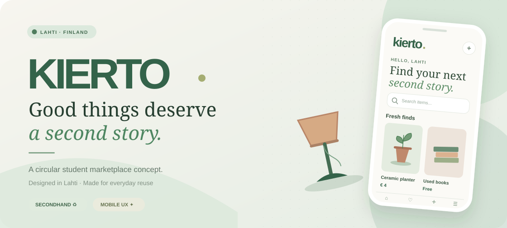

<div align="center">
  <a href="https://sabnumpariyar-png.github.io/KIERTO-Lahti/"></a>

  <a href="https://sabnumpariyar-png.github.io/KIERTO-Lahti/"></a>

  <p><strong>A little more life for the things we already have.</strong></p>
  <p>Mobile-first UX concept · Circular economy · Student life in Lahti, Finland</p>
</div>

---

## 🌿 Hello, I'm Sabnam

I'm **Sabnam Pariyar**, studying **Sustainable Design Business at LAB University of Applied Sciences** in Lahti, Finland.

I created **KIERTO Lahti** as an independent UI/UX portfolio concept. My starting question was simple: **What if finding and passing on useful secondhand items felt easier within our local student community?**

I wanted to connect something I care about—making more thoughtful use of everyday resources—with a digital experience that feels welcoming, useful, and easy to understand.

> **A working concept, not a live marketplace.** The listings, names, prices, and pickup details are fictional. Browsing, saving, offering, and reserving are simulated. KIERTO is not an official LAB University service.

## ✦ Explore the experience

| | Experience | What I made |
| :---: | --- | --- |
| 🔎 | **Discover** | A feed of 25 sample secondhand items, with search and eight categories |
| ♡ | **Save** | A favorites flow for collecting interesting finds |
| 📍 | **Explore details** | Condition, price, item description, and local pickup area |
| 📅 | **Reserve** | A simulated pickup-day selection and reservation confirmation |
| ＋ | **Give an item** | A lightweight form for adding a temporary sample listing |
| ☷ | **Activity** | A simple overview of saved, reserved, and offered items |

The prototype runs entirely in the browser. **There are no real sellers, accounts, payments, messages, or persistent reservations.**

## 🎨 The look and feel

<p align="center"></p>

I chose an **earthy, soft visual language** so the interface feels more like a friendly community space than a busy shopping platform.

- **Moss green** for actions and direction, paired with warm ivory backgrounds.
- **Clear, rounded item cards** that make condition, price, and location easy to scan.
- **A simple visual hierarchy** with one main action at a time.
- **Mobile-first layouts** that also work on larger screens.
- **Friendly illustrations** that give the prototype a consistent, recognizable character.

These are my initial choices. I still want to check them with real students instead of assuming they work perfectly.

## ♻️ Why this idea matters to me

When someone moves into a student room, they might need a lamp, a chair, books, or kitchenware. Someone else nearby might already have those things and no longer need them.

KIERTO explores how a local service might make that exchange simpler. My goal at this stage is to **design and test the experience**—not to claim that the prototype has already reduced waste or changed behavior.

I am especially interested in three questions:

1. How quickly can someone find a useful item?
2. What information helps them feel comfortable arranging pickup?
3. How simple can the process of giving something away become?

## ✍️ My design process

This is an early, interactive concept. I have created the first flows and documented my assumptions, but **I have not yet completed formal user interviews, usability testing, or impact measurement**.

My next steps are to speak with students in Lahti, observe where they struggle in the prototype, improve the flows based on what I learn, and document the iterations in Figma and my case study.

**[Read my UX case study →](docs/UX_CASE_STUDY.md)**

## 🛠️ Inside the prototype

| Design and development | Details |
| --- | --- |
| **Interface** | React 19, Vite 7, JavaScript, CSS |
| **Visual assets** | Local SVG illustrations and icons |
| **Layout** | Responsive, mobile-first |
| **Data** | 25 fictional listings across eight categories |
| **Interactions** | Browser-side state for search, favorites, reservations, and sample listings |
| **Deployment** | GitHub Actions → GitHub Pages (once Pages is enabled) |

### Run locally

Use Node.js **20.19+**.

```bash
npm install
npm run dev
```

For a production build:

```bash
npm run build
```

### View online

Once GitHub Pages is enabled under **Settings → Pages → Source: GitHub Actions**, the live demo should appear at:

**https://sabnumpariyar-png.github.io/KIERTO-Lahti/**

Until then, please run it locally. The preview artwork above links to this planned GitHub Pages address.

---

<div align="center">
  <strong>KIERTO · Lahti</strong><br />
  <em>Good things deserve a second story.</em><br /><br />
  <sub>Made as an independent learning and portfolio project by Sabnam Pariyar · Lahti, Finland.</sub><br />
  <sub>Not affiliated with or endorsed by LAB University of Applied Sciences.</sub>
</div>
