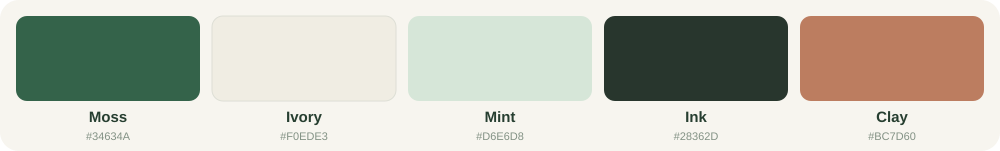

  

  
<strong>A second life for things. A better start for someone else.</strong>

  
UI/UX case study & interactive concept · Circular design · Lahti, Finland

  

## A little more life for the things we already have

I'm **Sabnam Pariyar**, studying Sustainable Design Business at LAB University of Applied Sciences in Lahti.

I imagined KIERTO while thinking about something familiar in student life: one person needs a lamp, chair, or kitchen item, while someone nearby has one they no longer use. I wanted to explore how a small, local digital experience might help those things find their next home.

**KIERTO Lahti is my mobile-first UI/UX concept for discovering, saving, and passing on secondhand essentials within a student community.** I designed it as a calm, welcoming alternative to the feeling of scrolling through a crowded marketplace.

<em>My starting design question: How might sharing everyday items feel as easy as finding them?</em>

## What you can explore

The interactive prototype follows two simple journeys:

- **Find something useful.** Browse local listings, search by name or category, check condition and pickup area, save favorites, and try a simulated reservation.
- **Give something another life.** Create a sample listing with a short form and see it appear in the collection.

I also added an Activity view, so it's easy to see what you've saved, offered, or tried to reserve.

The listings and exchanges are fictional. This is a working design concept, not a real buying or reservation service.

## The visual direction

I wanted KIERTO to feel **quietly Nordic, warm, and useful**. The palette takes its cues from natural materials, lived-in objects, and spaces where things have room to breathe.

- **Moss and sage** make the experience feel grounded; the deeper green helps important actions stand out.
- **Cream and ink** keep the screens soft but readable, with a clear hierarchy.
- **Clay** adds a small human touch without making the interface feel busy.
- **Rounded cards, generous imagery, and familiar icons** help people focus on the item rather than the interface.

These are design choices I'd like to validate with students, not research findings.

## The moodboard has a second side

Scroll below the mobile app to find my **interactive design story**. I wanted the portfolio itself to demonstrate the decisions behind the interface:

1. **Flip three moodboard cards** to see why I chose furniture, everyday objects, and soft textiles as visual references.
2. **Tap the five color swatches** to see how a button changes in moss, sage, cream, ink, and clay.
3. **Try a few UI components**—save an item, filter sample results, or open a main action.
4. **Explore the UX journey** to see the questions I'm still asking about discovery, trust, and handover.

The idea is to show both how KIERTO looks and **why I made it feel this way**.

## The thinking behind the screens

| What I designed | Why I chose it |
| --- | --- |
| Search and simple categories | To help someone get to an everyday essential quickly |
| Item condition, price, and pickup area | To make the information needed for a decision visible |
| One prominent action on each screen | To make the next step easier to recognize |
| Favorites and Activity | To help people return to things they were considering |
| A short Give form | To lower the effort of passing something on |

I began with a concept and designed the first flows around those assumptions. I haven't completed formal interviews, usability tests, or environmental-impact measurements. My next step is to talk to students in Lahti, test the journeys, and refine what doesn't work.

**[Explore my full UX case study](docs/UX_CASE_STUDY.md)** — the problem, early decisions, design hypotheses, and what I'd test next.

---

  <strong>kierto.</strong> 
  <em>Good things deserve a second story.</em>  
  Independent UI/UX portfolio concept by Sabnam Pariyar · Lahti, Finland 
  Not an official LAB University service.

